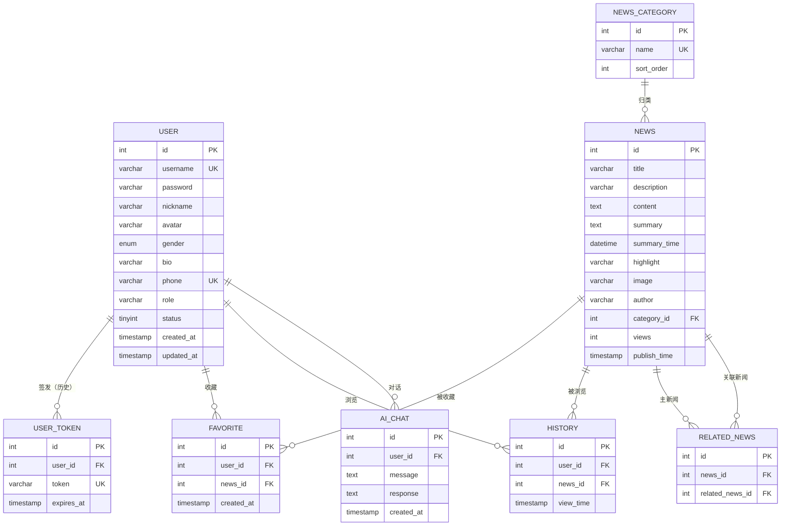

# 数据库设计

> 数据库：MySQL 8.x　｜　库名：`news_app`　｜　字符集：`utf8mb4` / `utf8mb4_unicode_ci`　｜　存储引擎：InnoDB

本文档描述 8 张表的完整字段字典、主外键与索引设计、冗余字段的取舍理由，以及建表脚本与 ORM 模型之间的差异说明。

---

## 1. 设计概览

### 1.1 设计原则

| 原则 | 落地方式 |
| --- | --- |
| 读写分离关注点 | 新闻正文与 AI 摘要分离存储在 `news` 同一行，读详情时一次取回，避免二次查询 |
| 反范式换性能 | `news.views` 直接存计数，不做 `COUNT(history)` 实时聚合；热榜与统计直接读该字段 |
| 缓存型冗余 | `summary` / `highlight` / `summary_time` 是"模型产出的缓存"，正文变更即整体清空 |
| 唯一性用约束兜底 | 收藏用 `UNIQUE(user_id, news_id)`，并发重复提交由数据库拦住，业务层只做友好提示 |
| 级联交给外键 | 用户删除 → 收藏/历史/对话级联删除；新闻删除 → 收藏/历史/关联级联删除 |
| 时间双轨 | 业务时间（`publish_time` / `view_time`）与审计时间（`created_at` / `updated_at`）分开 |

### 1.2 表清单

| # | 表名 | 中文名 | 行量级 | 说明 |
| --- | --- | --- | --- | --- |
| 1 | `user` | 用户表 | 千–万 | 账号、资料、角色、状态 |
| 2 | `user_token` | 用户令牌表 | 千–万 | 旧版令牌鉴权遗留，当前仅结构兼容 |
| 3 | `news_category` | 新闻分类表 | 个位数–几十 | 头条/社会/科技等频道 |
| 4 | `news` | 新闻表 | 万–百万 | 核心业务表，含 AI 摘要字段 |
| 5 | `related_news` | 相关新闻关联表 | 万–百万 | 推荐关系，当前**未启用**（见 §5.4） |
| 6 | `favorite` | 收藏表 | 万–百万 | 用户 × 新闻 唯一 |
| 7 | `history` | 浏览历史表 | 万–百万 | 用户 × 新闻 唯一（同一篇只留最后一次） |
| 8 | `ai_chat` | AI 对话记录表 | 万–百万 | 一问一答一行 |

### 1.3 ER 图



### 1.4 外键拓扑

| 子表 | 外键 | 父表 | 删除行为 | 更新行为 |
| --- | --- | --- | --- | --- |
| `user_token` | `user_id` | `user.id` | CASCADE | CASCADE |
| `news` | `category_id` | `news_category.id` | **RESTRICT** | CASCADE |
| `related_news` | `news_id` | `news.id` | CASCADE | CASCADE |
| `related_news` | `related_news_id` | `news.id` | CASCADE | CASCADE |
| `favorite` | `user_id` | `user.id` | CASCADE | CASCADE |
| `favorite` | `news_id` | `news.id` | CASCADE | CASCADE |
| `history` | `user_id` | `user.id` | CASCADE | CASCADE |
| `history` | `news_id` | `news.id` | CASCADE | CASCADE |
| `ai_chat` | `user_id` | `user.id` | CASCADE | CASCADE |

> `news.category_id` 用 `RESTRICT`：分类是新闻的强归属，不允许因误删分类而丢失新闻。业务层删除分类需先迁移新闻（当前未开放分类删除接口）。

---

## 2. 字段字典

### 2.1 `user` 用户表

| 字段 | 类型 | 空 | 默认 | 键/索引 | 说明 |
| --- | --- | :-: | --- | --- | --- |
| `id` | INT UNSIGNED | 否 | AUTO_INCREMENT | PK | 用户 ID |
| `username` | VARCHAR(50) | 否 | — | UNIQUE | 登录名，2–50 字符 |
| `password` | VARCHAR(255) | 否 | — | — | bcrypt 哈希（`$2b$12$...`，60 字符，留足余量） |
| `nickname` | VARCHAR(50) | 是 | NULL | — | 昵称，缺省取 username |
| `avatar` | VARCHAR(255) | 是 | NULL | — | 头像 URL（`/uploads/xxx` 或外链） |
| `gender` | ENUM('male','female','unknown') | 是 | `unknown` | — | 性别 |
| `bio` | VARCHAR(500) | 是 | NULL | — | 个人简介 |
| `phone` | VARCHAR(20) | 是 | NULL | UNIQUE | 手机号，可空但不可重复 |
| `role` | VARCHAR(20) | 否 | `user` | — | `admin` / `user`（v2 新增） |
| `status` | TINYINT | 否 | `1` | — | `1` 正常 / `0` 禁用（v2 新增） |
| `created_at` | TIMESTAMP | 否 | CURRENT_TIMESTAMP | — | 注册时间 |
| `updated_at` | TIMESTAMP | 否 | CURRENT_TIMESTAMP ON UPDATE | — | 资料更新时间 |

**业务约束**（服务层实现，非数据库约束）：

- 系统至少保留 1 名 `admin`；
- 不能禁用 / 删除当前登录账号；
- 不能取消当前登录账号的管理员身份；
- `role` 只接受 `admin` / `user`，`status` 只接受 `0` / `1`。

### 2.2 `user_token` 用户令牌表

| 字段 | 类型 | 空 | 默认 | 键/索引 | 说明 |
| --- | --- | :-: | --- | --- | --- |
| `id` | INT UNSIGNED | 否 | AUTO_INCREMENT | PK | 令牌 ID |
| `user_id` | INT UNSIGNED | 否 | — | FK / INDEX | 归属用户 |
| `token` | VARCHAR(255) | 否 | — | UNIQUE | 令牌值 |
| `expires_at` | TIMESTAMP | 否 | — | — | 过期时间 |
| `created_at` | TIMESTAMP | 否 | CURRENT_TIMESTAMP | — | 签发时间 |

> **现状**：v2 改用无状态 JWT，该表不参与任何业务查询，仅保留结构以兼容历史库。ORM 中有对应模型 `UserToken`，但代码中无读写。若不考虑兼容，可在后续版本直接 `DROP`。

### 2.3 `news_category` 新闻分类表

| 字段 | 类型 | 空 | 默认 | 键/索引 | 说明 |
| --- | --- | :-: | --- | --- | --- |
| `id` | INT UNSIGNED | 否 | AUTO_INCREMENT | PK | 分类 ID |
| `name` | VARCHAR(50) | 否 | — | UNIQUE | 分类名称（头条/社会/国内/国际/娱乐/体育/科技/财经） |
| `sort_order` | INT | 否 | `0` | — | 展示顺序，升序 |
| `created_at` | TIMESTAMP | 否 | CURRENT_TIMESTAMP | — | 创建时间 |
| `updated_at` | TIMESTAMP | 否 | CURRENT_TIMESTAMP ON UPDATE | — | 更新时间 |

> `sort_order` 而非 `ORDER BY id`：允许运营把"头条"固定在前，同时保留新增分类的灵活性。

### 2.4 `news` 新闻表

| 字段 | 类型 | 空 | 默认 | 键/索引 | 说明 |
| --- | --- | :-: | --- | --- | --- |
| `id` | INT UNSIGNED | 否 | AUTO_INCREMENT | PK | 新闻 ID |
| `title` | VARCHAR(255) | 否 | — | — | 标题，2–255 字符 |
| `description` | VARCHAR(500) | 是 | NULL | — | 简介；新增时缺省取正文前 120 字 |
| `content` | TEXT | 否 | — | — | 正文（TEXT 上限约 64KB） |
| `summary` | TEXT | 是 | NULL | — | AI 摘要（Markdown，约 100–280 字） |
| `summary_time` | DATETIME | 是 | NULL | — | 摘要生成时间，用于展示"生成于…" |
| `highlight` | VARCHAR(255) | 是 | NULL | — | 一句话看点（服务层截断至 80 字） |
| `image` | VARCHAR(255) | 是 | NULL | — | 封面 URL |
| `author` | VARCHAR(50) | 是 | NULL | — | 作者，缺省 `平台编辑`；统计时空值归 `未知作者` |
| `category_id` | INT UNSIGNED | 否 | — | FK / INDEX | 分类 |
| `views` | INT UNSIGNED | 否 | `0` | — | 浏览量（详情页每次访问 +1） |
| `publish_time` | TIMESTAMP | 否 | CURRENT_TIMESTAMP | INDEX DESC | 发布时间，列表与趋势的主排序键 |
| `created_at` | TIMESTAMP | 否 | CURRENT_TIMESTAMP | — | 入库时间 |
| `updated_at` | TIMESTAMP | 否 | CURRENT_TIMESTAMP ON UPDATE | — | 更新时间 |

**为什么摘要不单独建表？**

- 摘要与新闻是 1:1，且永远随新闻一起读（列表项也展示 `summary`），独立表会让列表查询多一次 JOIN；
- 摘要失效是"整条清空"而非增量更新，没有多版本需求；
- 代价是 `news` 行变宽，但 TEXT 字段在 InnoDB 中通常是行外存储，对主表扫描影响可控。

**为什么 `views` 不做实时聚合？**

`COUNT(history)` 只能统计登录用户的浏览，且每次列表/热榜/统计都要聚合，代价高。反范式存计数后，热榜排序、统计总览都是单列扫描。

### 2.5 `related_news` 相关新闻关联表

| 字段 | 类型 | 空 | 默认 | 键/索引 | 说明 |
| --- | --- | :-: | --- | --- | --- |
| `id` | INT UNSIGNED | 否 | AUTO_INCREMENT | PK | 关联 ID |
| `news_id` | INT UNSIGNED | 否 | — | FK / INDEX | 主新闻 |
| `related_news_id` | INT UNSIGNED | 否 | — | FK / INDEX | 被推荐新闻 |
| `created_at` | TIMESTAMP | 否 | CURRENT_TIMESTAMP | — | 创建时间 |

唯一约束：`UNIQUE(news_id, related_news_id)`，防止同一对关系重复写入。

> **当前未启用**：ORM 中未建模，业务代码也不读写。详情页的"相关推荐"是用 `同分类 + 按 views 倒序 + 取 5 条` 实时算出来的（见 `news_service._build_detail`）。保留该表是为后续引入人工推荐 / 协同过滤结果留位置。

### 2.6 `favorite` 收藏表

| 字段 | 类型 | 空 | 默认 | 键/索引 | 说明 |
| --- | --- | :-: | --- | --- | --- |
| `id` | INT UNSIGNED | 否 | AUTO_INCREMENT | PK | 收藏 ID |
| `user_id` | INT UNSIGNED | 否 | — | FK / INDEX | 用户 |
| `news_id` | INT UNSIGNED | 否 | — | FK / INDEX | 新闻 |
| `created_at` | TIMESTAMP | 否 | CURRENT_TIMESTAMP | — | 收藏时间 |

唯一约束 `UNIQUE(user_id, news_id)`：同一用户同一新闻只能收藏一次。并发重复提交时由数据库抛 `IntegrityError`，全局异常处理器翻译为 `已经收藏过该新闻`。

### 2.7 `history` 浏览历史表

| 字段 | 类型 | 空 | 默认 | 键/索引 | 说明 |
| --- | --- | :-: | --- | --- | --- |
| `id` | INT UNSIGNED | 否 | AUTO_INCREMENT | PK | 历史 ID |
| `user_id` | INT UNSIGNED | 否 | — | FK / INDEX | 用户 |
| `news_id` | INT UNSIGNED | 否 | — | FK / INDEX | 新闻 |
| `view_time` | TIMESTAMP | 否 | CURRENT_TIMESTAMP | INDEX DESC | 最近一次浏览时间 |

> 无 `UNIQUE(user_id, news_id)`：业务层用"存在则更新 `view_time`"实现"同一篇只留一条最新记录"。这样历史列表不会因反复打开同一篇而刷屏，同时保留时间线排序能力。

### 2.8 `ai_chat` AI 对话记录表

| 字段 | 类型 | 空 | 默认 | 键/索引 | 说明 |
| --- | --- | :-: | --- | --- | --- |
| `id` | INT UNSIGNED | 否 | AUTO_INCREMENT | PK | 记录 ID |
| `user_id` | INT UNSIGNED | 否 | — | FK / INDEX | 用户 |
| `message` | TEXT | 否 | — | — | 用户问题（写入前截断 6000 字） |
| `response` | TEXT | 否 | — | — | AI 回答（Markdown，截断 12000 字） |
| `created_at` | TIMESTAMP | 否 | CURRENT_TIMESTAMP | INDEX DESC | 对话时间 |

> 只存"最后一问 + 最终回答"，不存中间工具调用与 token 流。多轮上下文由前端每次把最近 16 条 `messages` 一起提交，服务端不再拼接历史。

---

## 3. 索引设计

### 3.1 索引清单

| 表 | 索引名 | 类型 | 列 | 支撑的查询 |
| --- | --- | --- | --- | --- |
| `user` | PRIMARY | 聚簇 | `id` | 主键查找 |
| `user` | `username_UNIQUE` | 唯一 | `username` | 登录、注册查重、用户搜索 |
| `user` | `phone_UNIQUE` | 唯一 | `phone` | 手机号查重 |
| `user_token` | `token_UNIQUE` | 唯一 | `token` | 历史令牌校验（当前未用） |
| `user_token` | `fk_user_token_user_idx` | 普通 | `user_id` | 按用户查令牌 |
| `news_category` | `name_UNIQUE` | 唯一 | `name` | 分类名唯一 |
| `news` | `fk_news_category_idx` | 普通 | `category_id` | 分类筛选、相关推荐 |
| `news` | `idx_publish_time` | 普通（DESC） | `publish_time` | 列表最新排序、趋势、区间统计 |
| `related_news` | `news_related_unique` | 唯一 | `news_id, related_news_id` | 关系去重 |
| `related_news` | `fk_related_news_news_idx` | 普通 | `news_id` | 查某新闻的推荐 |
| `related_news` | `fk_related_news_related_idx` | 普通 | `related_news_id` | 反查被推荐 |
| `favorite` | `user_news_unique` | 唯一 | `user_id, news_id` | 收藏状态判断、防重复 |
| `favorite` | `fk_favorite_user_idx` | 普通 | `user_id` | 我的收藏列表 |
| `favorite` | `fk_favorite_news_idx` | 普通 | `news_id` | 新闻收藏数、热榜 |
| `history` | `fk_history_user_idx` | 普通 | `user_id` | 我的历史列表 |
| `history` | `fk_history_news_idx` | 普通 | `news_id` | 按新闻统计 |
| `history` | `idx_view_time` | 普通（DESC） | `view_time` | 历史排序、今日浏览统计 |
| `ai_chat` | `fk_ai_chat_user_idx` | 普通 | `user_id` | 对话历史列表 |
| `ai_chat` | `idx_created_at` | 普通（DESC） | `created_at` | 对话时间排序 |

### 3.2 设计取舍

- **不建 `views` 索引**：`ORDER BY views` 只用于"最热"排序与热榜候选集，数据量大时全表排序代价高。当前做法是"按 views 取候选 + 内存综合排序"，候选上限 `max(limit*6, 60)`。若新闻量级超过 10 万，应改为物化热榜表或引入 `(category_id, views)` 组合索引。
- **`(user_id, news_id)` 用唯一索引而非联合主键**：保留自增 `id` 便于按收藏顺序翻页。
- **时间索引带 DESC**：MySQL 8 支持降序索引，`ORDER BY publish_time DESC` 可直接走索引；MySQL 5.7 会忽略 DESC 但仍可反向扫描。
- **`keywords` 检索无索引**：`title/description/content` 的 `LIKE '%kw%'` 无法命中 B-Tree。当前数据量可接受；后续建议 MySQL 全文索引（ngram）或 Elasticsearch。
- **未建 `(category_id, publish_time)` 组合索引**：分类页同时按发布时间排序时会走 `idx_publish_time` 再过滤，选择性尚可。若分类页成为主入口，建议补组合索引。

---

## 4. 数据字典

| 字段 | 取值 | 含义 |
| --- | --- | --- |
| `user.role` | `admin` | 管理员，可访问 3 个管理页与全部管理接口 |
| | `user` | 普通用户，默认注册角色 |
| `user.status` | `1` | 正常 |
| | `0` | 禁用（登录被拒、已签发 Token 立即失效，因为每次请求都查库校验 status） |
| `user.gender` | `male` / `female` / `unknown` | 性别，默认 `unknown` |
| `news.order`（接口参数） | `latest` | 按 `publish_time` 倒序 |
| | `hot` | 按 `views` 倒序，再按时间倒序 |
| `ai_chat` 无状态字段 | — | 记录只保留最终问答，不区分成功/失败 |

---

## 5. 初始化与迁移

> **实库现状（已核对）**：应用当前连接的是 `news_app_v2`，8 张表齐全，`news` 403 条、`user` 2 个、`news_category` 8 个。表由**手写 DDL** 创建（带表/列注释、`INT UNSIGNED`、`ENUM gender`、`idx_publish_time DESC`），不是 `create_all` 的产物。仓库中的 `database.sql` 已于 2026-11 自实库反向导出，结构与运行库一致，见 §5.5。

### 5.1 全量初始化（`database.sql`）

1. `CREATE DATABASE IF NOT EXISTS news_app`（utf8mb4 / utf8mb4_unicode_ci）
2. 依次建 8 张表与全部索引、外键
3. 插入 8 个分类（`头条`…`财经`，`sort_order` 1–8）
4. 插入多批演示新闻（发布时间集中在 2023-08，含浏览量）
5. 插入 2 个演示账号：`admin` / `user`，密码均为 `123456`（bcrypt）

```bash
mysql -u root -p < "数据库sql文件/database.sql"
```

> ⚠️ 脚本建的是 `news_app`，而 `.env` 当前连 `news_app_v2`。导入后需改连接串或改脚本库名，否则应用看到的是另一个空库。

### 5.2 增量升级（`migration_v2.sql`）

针对"已经存在旧版库"的场景，只补字段不重建：

```sql
ALTER TABLE `user`
  ADD COLUMN `role`   VARCHAR(20) NOT NULL DEFAULT 'user' AFTER `phone`,
  ADD COLUMN `status` TINYINT     NOT NULL DEFAULT 1      AFTER `role`;

ALTER TABLE `news`
  ADD COLUMN `summary`      TEXT         NULL AFTER `content`,
  ADD COLUMN `summary_time` DATETIME     NULL AFTER `summary`,
  ADD COLUMN `highlight`    VARCHAR(255) NULL AFTER `summary_time`;

UPDATE `user` SET `role`='admin', `status`=1 WHERE `username`='admin';
```

### 5.3 应用启动时的自动迁移

`app/database.py::init_db()` 在每次启动时执行：

1. `Base.metadata.create_all` —— 只建缺失的表，不动已有表；
2. `_migrate()` —— 用 `inspect()` 读列名，缺 `user.role/status`、`news.summary/summary_time/highlight` 时执行对应 `ALTER`；
3. `_seed()` —— 分类为空则写入 8 个分类；`admin` 不存在则创建，存在则修正 `role/status`，并把旧演示密码 `123` 统一为 `123456`；`user` 不存在则创建。

> 这是**轻量迁移**，不支持删列/改类型/重命名。字段继续演进时应引入 Alembic 版本化管理。

### 5.4 建表脚本与 ORM 的差异

| 项 | `database.sql` | SQLAlchemy 模型 | 影响 |
| --- | --- | --- | --- |
| 主键/外键类型 | `INT UNSIGNED` | `Integer`（有符号） | 由 SQL 建库时以 UNSIGNED 为准，理论容量 42 亿；由 `create_all` 建库时为有符号 |
| `user.gender` | `ENUM(...)` | `String(10)` | SQL 建库有枚举约束；`create_all` 建库无约束，非法值可写入 |
| `publish_time` / `created_at` | `TIMESTAMP` + 数据库默认值/自动更新 | `DateTime` + Python `default=datetime.now`、`onupdate` | SQL 建库时间由数据库生成；`create_all` 建库由应用生成（多实例时钟需一致） |
| `updated_at` | `ON UPDATE CURRENT_TIMESTAMP` | `onupdate=datetime.now` | 同上 |
| `idx_publish_time` | `DESC` | 普通索引 | 仅影响执行计划细节 |
| `related_news` | 有表 | 无模型 | ORM 不管理该表，`create_all` 不会创建它（走 SQL 建库才有） |

> 实践建议：**生产环境统一用 `database.sql` 建库**，让类型、枚举、时间默认值以数据库为准；`create_all` 只作为"本地快速起一个空库"的兜底。

### 5.5 脚本与实库的一致性

2026-11-08 使用 `mysqldump --no-data news_app_v2` 从实际运行库反向导出，覆盖原 `database.sql`。当前脚本与实库结构逐行比对一致：

| 项 | 状态 |
| --- | --- |
| 库名 | 脚本与 `.env` 的 `DATABASE_URL` 均为 `news_app_v2` |
| `user.role` | `VARCHAR(50) COMMENT '角色'`，位于 `id` 之后（与实库一致） |
| 表数量 | 8 张，包含 ORM 未建模的 `related_news` / `user_token` |
| 索引 / 外键 | 与实库同名：`fk_news_category_idx`、`fk_news_category`、`idx_publish_time DESC` |
| 业务数据 | 脚本不含数据；8 个分类与 2 个演示账号由 `init_db()` 启动时写入 |

原脚本与实库的历史差异（库名 `news_app`、`role VARCHAR(20)` 且位于 `phone` 之后）已随本次重新导出消除，原文件保留为 `database.sql.bak`。

### 5.6 演示数据说明

- 分类 8 个：头条、社会、国内、国际、娱乐、体育、科技、财经；
- 新闻若干条，`publish_time` 集中在 2023 年 8 月，`image` 为 `picsum.photos` 占位图；
- 账号 2 个：`admin`（管理员）、`user`（普通用户），密码 `123456`。

> 演示新闻时间较早，AI 助手按"最近 7 天"检索会查不到，联调时把 `days` 设为 `0`。

---

## 6. 典型查询与执行路径

| 业务 | 关键 SQL | 命中索引 |
| --- | --- | --- |
| 登录 | `SELECT * FROM user WHERE username = ?` | `username_UNIQUE` |
| 新闻列表（最新） | `SELECT ... FROM news WHERE category_id=? ORDER BY publish_time DESC LIMIT ?` | `fk_news_category_idx` + `idx_publish_time` |
| 新闻列表（最热） | `... ORDER BY views DESC, publish_time DESC` | 无（排序） |
| 关键词检索 | `... WHERE title LIKE '%kw%' OR description LIKE ...` | 无（全表扫描） |
| 新闻详情 | `SELECT * FROM news WHERE id=?` | PK |
| 收藏数 | `SELECT COUNT(*) FROM favorite WHERE news_id=?` | `fk_favorite_news_idx` |
| 是否已收藏 | `SELECT id FROM favorite WHERE user_id=? AND news_id=?` | `user_news_unique` |
| 相关推荐 | `... WHERE category_id=? AND id<>? ORDER BY views DESC LIMIT 5` | `fk_news_category_idx` |
| 热榜候选 | `... ORDER BY views DESC LIMIT 60` | 无（排序） |
| 我的收藏 | `... WHERE user_id=? ORDER BY created_at DESC LIMIT ?` | `fk_favorite_user_idx` |
| 发布趋势 | `SELECT DATE(publish_time), COUNT(*) ... GROUP BY DATE(...)` | `idx_publish_time` |
| 今日浏览 | `SELECT COUNT(*) FROM history WHERE view_time >= ?` | `idx_view_time` |

---

## 7. 容量与增长估算

以 10 万条新闻、1 万用户、50 万条收藏/历史为参考：

| 表 | 单行估算 | 10 万行量级 | 备注 |
| --- | --- | --- | --- |
| `news` | 标题 + 简介 + 正文（均值 1–2KB）+ 摘要（0.3KB） | 150–250 MB | 正文/摘要为 TEXT，行外存储 |
| `favorite` | ~40 B | 20 MB（50 万行） | 两个索引额外约 20 MB |
| `history` | ~40 B | 20 MB（50 万行） | 同上 |
| `ai_chat` | 问题 + 回答（均值 1–3KB） | 100 MB（5 万条） | 可通过定期归档控制 |
| `user` | ~200 B | 2 MB | — |

增长最快的是 `history` 与 `ai_chat`，建议：

- `history` 按用户维度只保留最近 N 条（如 200），或按月分区；
- `ai_chat` 保留 90 天，历史归档到冷存储；
- `news` 的 `summary` 可考虑单独表存储（若未来需要多版本摘要或多模型对比）。

---

## 8. 备份与运维建议

| 项 | 建议 |
| --- | --- |
| 备份 | `mysqldump --single-transaction news_app` 每日全量 + binlog 增量 |
| 字符集 | 连接串必须带 `charset=utf8mb4`，否则 emoji 与部分中文标点会写入失败 |
| 时区 | 应用与数据库统一 `Asia/Shanghai`；`DATETIME/TIMESTAMP` 混用需注意时区转换 |
| 慢查询 | `long_query_time=1`，重点关注 `LIKE '%kw%'` 与 `ORDER BY views` |
| 连接数 | 应用侧 `pool_size=10 + max_overflow=20`，单实例最多 30 连接；多实例需按 `max_connections` 预留 |
| 外键检查 | 批量导入演示数据前可临时 `SET FOREIGN_KEY_CHECKS=0`，导入后恢复 |
