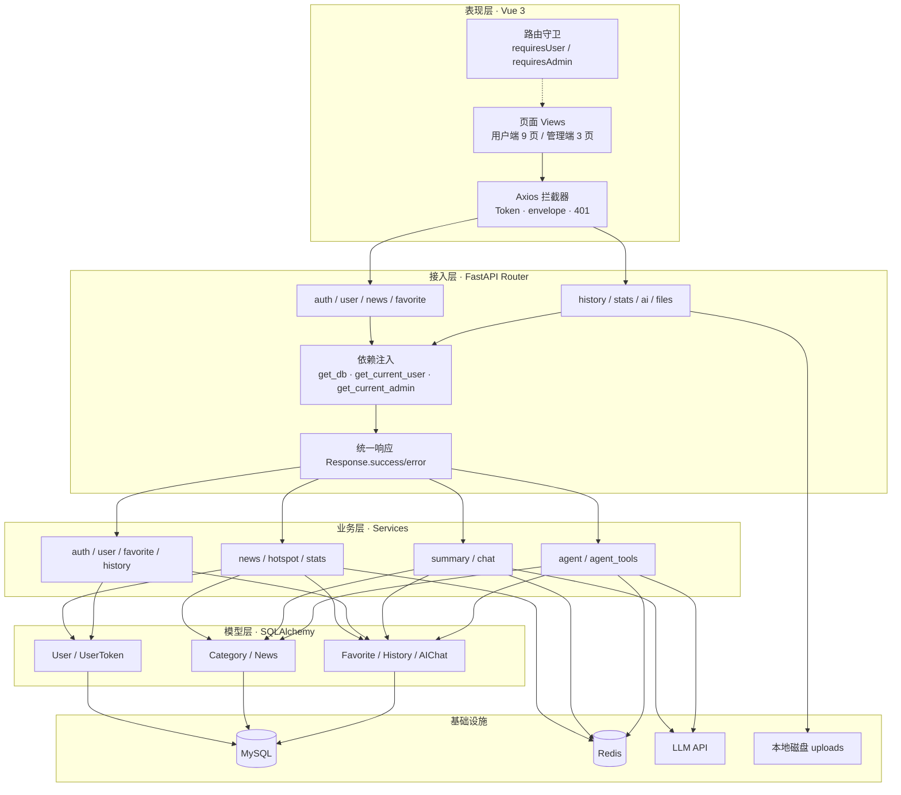
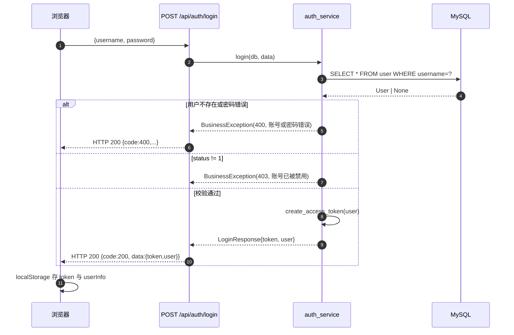
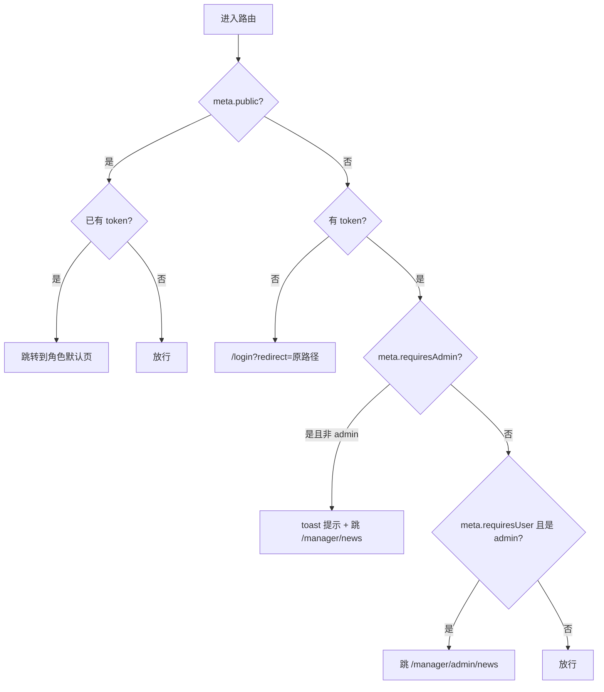
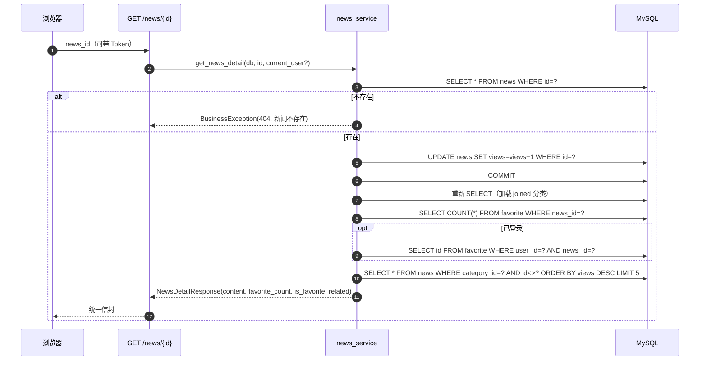
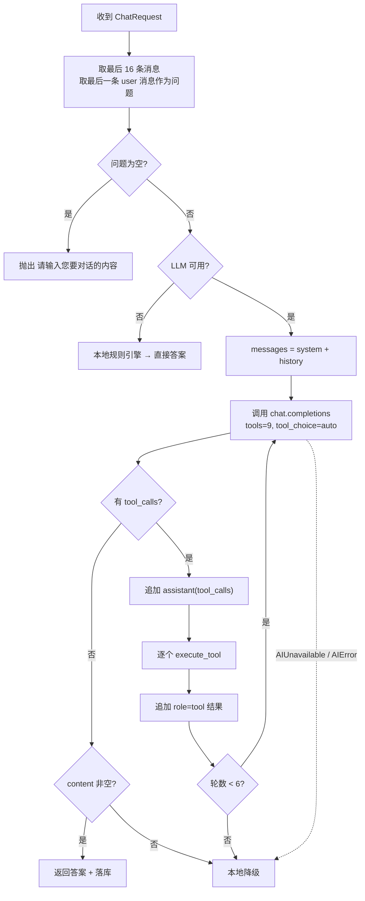
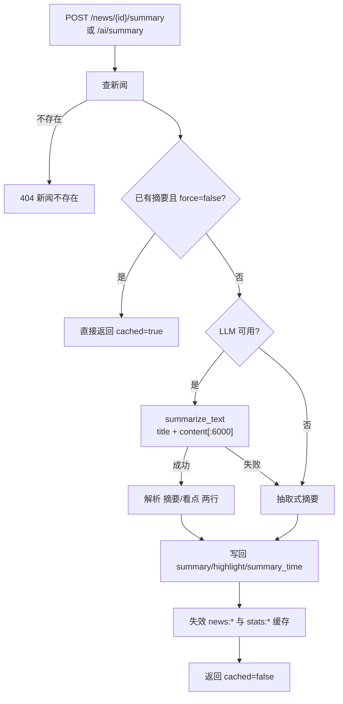
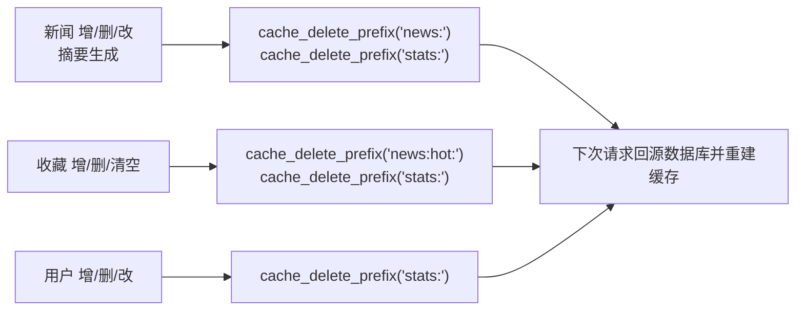

# 系统设计

> 版本：v2.0.0　｜　技术栈：FastAPI + SQLAlchemy 2.0（async）+ MySQL + Redis + Vue 3

本文档说明系统的分层结构、模块职责、六条核心业务流程、缓存与降级体系、安全设计、性能考量与演进方向。接口细节见 [API 接口文档](API接口文档.md)，表结构见 [数据库设计](数据库设计.md)。

---

## 1. 设计目标与约束

### 1.1 目标

| 目标 | 具体要求 | 实现手段 |
| --- | --- | --- |
| AI 不编造 | 回答必须来自数据库 | Agent 只通过 9 个受控工具取数；System Prompt 明令禁止使用模型自身知识；查不到如实返回 |
| 可用性 | 大模型/Redis 挂了网站仍能用 | 三级降级：LLM → 本地规则引擎 → 空结果提示；Redis 连接失败即静默跳过缓存 |
| 权限清晰 | 用户与管理员职责隔离 | JWT 携带 role；路由守卫 + 后端 `get_current_admin` 双重校验 |
| 全异步 | 单机支撑更高并发 | asyncmy + AsyncSession + redis.asyncio + AsyncOpenAI，全链路无阻塞 |
| 可观测 | 出问题能定位 | 结构化日志 + `/health` 真实探测数据库 + 启动打印 AI 模式 |
| 易上手 | 新人 10 分钟跑起来 | 单命令初始化、`.env` 集中配置、Swagger 自动文档、前端代理开箱即用 |

### 1.2 非目标（当前版本不做）

- 不做分布式部署与读写分离（单库单实例即可运行）；
- 不做实时爬虫/新闻源接入（新闻由管理员录入或 SQL 导入）；
- 不做细粒度 RBAC（只有 `admin` / `user` 两种角色）；
- 不做多租户、计费、审核流；
- 不做向量检索/RAG（检索基于 SQL `LIKE`）。

### 1.3 关键约束

| 约束 | 数值 | 来源 |
| --- | --- | --- |
| Agent 最大工具调用轮数 | 6 | `agent_service.MAX_TOOL_ROUNDS` |
| 对话上下文长度 | 最近 16 条消息 | `_build_history` |
| 摘要输入正文上限 | 6000 字 | `ai_service.summarize_text` |
| 分页上限 | 100 | `config.MAX_PAGE_SIZE` / `Query(le=100)` |
| 上传大小 | 10MB | `config.MAX_FILE_SIZE` |
| 上传类型 | jpg/jpeg/png/gif/webp/svg | `config.ALLOWED_EXTENSIONS` |
| JWT 有效期 | 72h | `JWT_EXPIRE_HOURS` |
| 热榜候选集 | `max(limit*6, 60)` | `hotspot_service.get_hot_news` |
| 相关推荐 | 同分类 5 条 | `news_service._build_detail` |
| LLM 超时 | 90s | `LLM_TIMEOUT` |

---

## 2. 总体架构

### 2.1 分层结构



### 2.2 模块职责

| 层 | 模块 | 职责 | 不做什么 |
| --- | --- | --- | --- |
| 路由 `api/` | `auth` `user` `news` `favorite` `history` `stats` `ai` `files` | 参数声明与校验、依赖注入、调用 service、包装 `Response` | 不写业务规则、不直接拼 SQL |
| 业务 `services/` | `auth_service` | 登录校验、注册、签发 JWT | 不处理 HTTP |
| | `user_service` | 资料/密码更新、用户 CRUD、管理员保护规则 | — |
| | `news_service` | 列表/详情/CRUD、相关推荐、AI 检索数据整形 | 不做摘要生成 |
| | `hotspot_service` | 热度打分与排序 | 不做文案解读 |
| | `stats_service` | 总览/趋势/分类/作者/区间统计 | 不做缓存失效 |
| | `favorite_service` `history_service` `chat_service` | 收藏、历史、对话记录 | — |
| | `summary_service` | 摘要生成、简报、热榜解读（含降级） | 不直接调 HTTP |
| | `agent_service` | 意图编排、工具循环、SSE 事件、本地降级 | 不定义工具本身 |
| | `agent_tools` | 9 个工具的 JSON Schema + 执行器 | 不决定何时调用 |
| | `ai_service` | LLM 客户端封装、Prompt、响应清洗 | 不感知业务表 |
| 模型 `models/` | `user` `news` `interaction` | ORM 映射、关系、索引 | 不含业务方法（除 `User.is_admin`） |
| 校验 `schemas/` | 7 个文件 | 请求/响应模型、字段约束 | 不做业务判断 |
| 公共 `common/` | `response` `exceptions` | 统一信封、`PageData`、异常映射 | — |
| 工具 `utils/` | `jwt` `password` `cache` | 签发解析、bcrypt、缓存读写与失效 | — |
| 依赖 `dependencies/` | `auth` | 解析 Bearer、查库校验状态与角色 | — |

### 2.3 部署拓扑（开发环境）

```
┌──────────────┐   /api、/uploads   ┌──────────────┐
│ 浏览器        │ ─────────────────▶ │ Vite Dev     │
│ localhost:5173│                    │ 127.0.0.1:5173│
└──────────────┘                    └──────┬───────┘
                                           │ proxy
                                           ▼
                                   ┌──────────────┐
                                   │ Uvicorn      │
                                   │ 127.0.0.1:8000│
                                   └──┬────┬───┬──┘
                                      │    │   │
                          ┌───────────┘    │   └────────────┐
                          ▼                ▼                ▼
                    ┌──────────┐     ┌──────────┐    ┌────────────┐
                    │ MySQL    │     │ Redis    │    │ LLM API    │
                    │ news_app │     │ (可选)   │    │ (可选)     │
                    └──────────┘     └──────────┘    └────────────┘
```

生产建议：`npm run build` 后将 `frontend/dist` 交给 Nginx 托管，Nginx 反代 `/api` 与 `/uploads` 到 Uvicorn；SSE 路径必须 `proxy_buffering off; proxy_read_timeout 300s;`。

---

## 3. 数据流与状态

### 3.1 核心实体关系

- 一个用户拥有多条收藏、历史、对话；同一新闻对同一用户只能收藏一次，历史只保留最近一次；
- 新闻必属一个分类，分类删除受 `RESTRICT` 保护；
- 新闻的 `views` 是累计计数，详情页访问即 +1；
- 新闻的 `summary/highlight/summary_time` 是模型产出缓存，标题或正文变更即清空。

### 3.2 状态机

**用户状态**

```
注册/创建 → status=1（正常）
              │ 管理员禁用
              ▼
          status=0（禁用）── 登录被拒 / 已签发 Token 立即失效（每次请求查库校验）
              │ 管理员启用
              ▼
          status=1
```

**新闻摘要状态**

```
无摘要 ──POST /summary──▶ 已生成 ──PUT 修改标题或正文──▶ 无摘要
   ▲                        │
   └──────force=true────────┘
```

**AI 会话状态**

```
用户提问 → [LLM 可用?]
   ├─ 否 → 本地规则引擎 → 流式输出 → 落库
   └─ 是 → 工具循环（≤6 轮）
            ├─ 模型给出最终回答 → 流式输出 → 落库
            ├─ 工具异常 → 错误结果回喂模型 → 继续
            └─ LLM 异常 → 本地降级（若已有部分输出则不切，直接报中断）
```

---

## 4. 认证与授权设计

### 4.1 登录时序



### 4.2 Token 结构与校验

签发（`utils/jwt.py`）：

```json
{
  "sub": "1",
  "user_id": 1,
  "username": "admin",
  "role": "admin",
  "iat": 1762300000,
  "exp": 1762559200
}
```

- 算法 `HS256`，密钥 `JWT_SECRET_KEY`，有效期 72h；
- 服务端**不存 Token**，无状态校验，天然支持多实例；
- 每次请求都 `db.get(User, user_id)` 并校验 `status==1`，因此"禁用账号"能立即生效，代价是每请求一次主键查询（可接受）。

校验依赖（`dependencies/auth.py`）：

| 依赖 | 行为 | 使用场景 |
| --- | --- | --- |
| `get_current_user` | 无 Token / 解析失败 / 用户不存在 / 被禁用 → 抛 HTTP 401 | 需要登录的 35 个接口 |
| `get_current_admin` | 在 `get_current_user` 基础上校验 `role=="admin"`，否则 `BusinessException(403)` | 管理端 9 个接口 |
| `get_optional_user` | 解析失败返回 `None`，不报错 | 新闻详情（用于返回 `is_favorite`） |

### 4.3 前端角色守卫



前后端职责划分：前端守卫负责**体验**（不让用户点到无权页面），后端依赖负责**安全**（直接调接口也会被拒）。二者不可互相替代。

---

## 5. 核心流程设计

### 5.1 新闻列表与详情

**列表**（`GET /api/news/list`）：

1. 组装动态条件：`category_id` 等值、`keywords` 对 `title/description/content` 三列 `ILIKE`、`author` 模糊；
2. 先 `COUNT` 总数，再按 `order` 排序分页（`latest` → `publish_time DESC`；`hot` → `views DESC`）；
3. 通过 `relationship(lazy="joined")` 一次 JOIN 取回分类名，避免 N+1；
4. 映射为 `NewsListItem`，返回 `PageData`。

**详情**（`GET /api/news/{id}`）：



设计说明：

- **先自增再重查**：异步 Session 下 `joined` 关系在 commit 后可能过期，重查保证分类名已加载，避免触发 `MissingGreenlet`；
- **相关推荐不走 `related_news` 表**：用同分类 + 浏览量排序实时计算，零维护成本；
- **浏览量写放大**：每次详情请求一次 `UPDATE + COMMIT`。当前量级可接受，高并发时应改为 Redis 计数 + 定时回写（见 §13）。

### 5.2 AI Agent（核心）

Agent 的职责不是"生成新闻"，而是"把用户问题翻译成工具调用，再把工具结果翻译成人话"。

#### 5.2.1 组成

| 组成 | 内容 |
| --- | --- |
| System Prompt | 7 条工作原则：只用数据库内容、必须调工具、查不到如实说、引用格式"标题（日期）"、摘要忠于原文、普通用户只可查询、中文 Markdown 输出 |
| 运行时上下文 | 追加"当前用户：昵称（角色）"与"当前时间：YYYY-MM-DD HH:MM" |
| 工具集 | 9 个（见下表） |
| 循环上限 | 6 轮，防止模型无限调工具 |
| 输出通道 | 非流式 `/api/ai/chat`、SSE `/api/ai/chat/stream` |
| 持久化 | 最终问答写入 `ai_chat`；写失败仅告警，不影响回答 |

#### 5.2.2 工具清单

| 工具名 | 用途 | 主要参数 | 底层服务 |
| --- | --- | --- | --- |
| `search_news` | 按关键词/分类/时间检索 | `keywords, category_id, days, limit(1–10)` | `news_service.search_news_for_ai` |
| `get_hot_news` | 汇总热榜 | `days, limit(1–20)` | `hotspot_service.get_hot_news` |
| `get_news_detail` | 读指定新闻全文 | `news_id`（必填） | `news_service.get_news_brief` |
| `summarize_news` | 生成/读取摘要 | `news_id`（必填） | `summary_service.summarize_news` |
| `get_news_stats` | 总量/今日/7 天/30 天/阅读/收藏 + 趋势 | `days` | `stats_service` |
| `get_publish_trend` | 每日发布数与阅读数 | `days`（必填，1–90） | `stats_service.get_trend` |
| `list_categories` | 分类及新闻数 | 无 | `news_service.get_categories` |
| `get_category_stats` | 分类的新闻/阅读/收藏 | 无 | `stats_service.get_category_stats` |
| `get_daily_digest` | 生成新闻简报 | `days, limit(1–20)` | `summary_service.daily_digest` |

工具执行器 `execute_tool` 的统一约定：

- 参数支持 JSON 字符串或 dict，解析失败按 `{}` 处理；
- 返回**给模型看的 JSON 字符串**（`ensure_ascii=False`）；
- 工具内异常不抛出，统一转为 `{"error": "..."}` 回喂模型，让模型自行决定"换个查法"或"如实说没查到"；
- 未知工具返回 `{"error": "未知工具：xxx"}`。

#### 5.2.3 非流式循环



#### 5.2.4 流式（SSE）循环

与非流式的差异：

1. 用 `stream_complete` 逐 chunk 消费；`delta.content` 立即以 `token` 事件下发，同时累积到 `visible_parts`；
2. `delta.tool_calls` 是**分片**到达的，按 `index` 聚合 `id / name / arguments`（arguments 需要字符串拼接）；
3. 一轮结束后若存在 `tool_calls`：追加 assistant 消息 → 对每个工具发 `tool_start` / `tool_end`（`preview` 截断 240 字符）→ 结果追加为 `role=tool` → 下一轮；
4. 无 `tool_calls` 时把累积文本作为最终答案，落库并发 `done`；
5. `AIUnavailable` → 切本地引擎（重新走一遍 `_emit_fallback`）；`AIError` 且已有输出 → 发 `error` 不再降级，避免"半截回答 + 另一套答案"拼接；
6. 异常兜底：`BusinessException` → `error(message)`；其他异常 → `error("AI 服务暂时不可用，请稍后重试")`。

**为什么要自定义 SSE 而不是标准 chat 协议？** 前端需要展示"正在调用哪个工具"，标准 `delta` 只有文本。这里用 6 种事件把 Agent 的中间状态显式暴露出来，前端可渲染"检索新闻数据库 → 命中 3 条"的过程条。

#### 5.2.5 本地规则引擎（降级）

无 Key 或调用失败时，`_fallback_compose` 按优先级匹配意图：

| 优先级 | 触发词 | 动作 | 输出 |
| --- | --- | --- | --- |
| 1 | `新闻/ID/第 N` + `摘要/总结/概括/看点` | `summarize_news` | 摘要 + 一句话看点 |
| 2 | `热榜/热门/排行/榜单/最火` | `get_hot_news`（识别 7天/30天） | 榜单 + 热度公式说明 |
| 3 | `统计/多少/新增/发布量/趋势/数据/总量/用户数` | `get_news_stats` | 总览 + ASCII 柱状趋势 |
| 4 | `简报/日报/汇总一下/新闻综述/今日新闻` | `get_daily_digest` | 简报 |
| 5 | `分类/频道` | `list_categories` | 分类及条数 |
| 6 | 默认 | `search_news`（去停用词抽关键词，最多 3 个） | 检索结果；无命中则回退最新 8 条并说明 |

停用词表覆盖"帮我/请问/最近/新闻/有什么/哪些/怎么/如何/统计/摘要"等 40 余词，先整词替换再按 `[A-Za-z0-9\u4e00-\u9fa5]{2,}` 切分，避免中文无空格导致整句被当成一个关键词。

降级模式同样会输出 `tool_start/tool_end` 事件（步骤由规则引擎构造），因此前端过程条在两种模式下表现一致。

### 5.3 摘要生成



关键规则：

- Prompt 要求"摘要 100–180 字、看点 ≤40 字、严格两行输出"；
- `_split_summary` 用正则提取 `摘要：` 与 `看点：`；模型不按格式输出时退化为"去掉标签行、截取 400 字"，看点取首句前 40 字；
- 清洗 `:cite[1]`、`[citation...]` 等模型偶发引用标记；
- **抽取式降级**：按 `。！？!?` 切句，取前 3 句（≤280 字）作"核心内容"，第 2–4 句作"关键信息"要点，首句前 60 字作看点；
- 摘要写入后立即失效缓存，保证列表/热榜看到新摘要。

### 5.4 热榜算法

```
score = views × 0.6
      + favorite_count × 40
      + max(0, 30 - age_days) × 3      # 越新加成越高，30 天后归零
      + (days > 0 且 age_days ≤ days ? 20 : 0)   # 窗口内命中额外加权
```

执行步骤：

1. 查缓存 `news:hot:{days}:{limit}:{category_id}`，命中直接返回；
2. 按 `views DESC, publish_time DESC` 取候选 `max(limit*6, 60)` 条（把"综合排序"降级为"小集合内存排序"）；
3. 一次 `GROUP BY news_id` 取候选集的收藏数，避免 N+1；
4. 内存打分、倒序、取前 `limit`，生成 `rank / score / favorite_count / hot_reason`；
5. 写缓存（TTL 300s）。

权重解释：阅读量是主信号（0.6/次），收藏是高价值信号（40/次，约等于 67 次阅读），时效加成最多 +90，窗口命中 +20。参数集中在 `hotspot_service`，便于调参。

### 5.5 统计口径

| 指标 | 口径 | 说明 |
| --- | --- | --- |
| `total_views` | `SUM(news.views)` | 累计阅读，含游客 |
| `today_views` | `COUNT(history WHERE view_time >= 今日 0 点)` | 登录用户的浏览次数 |
| `today_news` / `week_news` / `month_news` | `COUNT(news WHERE publish_time >= 起点)` | 按发布时间，非入库时间 |
| `total_summaries` | `COUNT(news WHERE summary IS NOT NULL)` | 已生成摘要的新闻数 |
| `total_users` / `active_users` | `COUNT(user)` / `COUNT(user WHERE status=1)` | **仅管理员可见** |
| 趋势 | 按 `DATE(publish_time)`、`DATE(view_time)` 分组 | 缺失日期补 0，保证折线连续 |

> 两个阅读口径并存是刻意的：`total_views` 反映内容消费规模（含游客），`today_views` 反映登录用户的活跃度。展示时需标注差异，避免运营误读。

### 5.6 收藏与历史

**收藏**：`add` 先查新闻存在 → 查是否已收藏 → 插入；并发下唯一索引兜底，`IntegrityError` 翻译为"已经收藏过该新闻"。增删后失效 `news:hot:` 与 `stats:`（收藏数参与热度与统计）。

**历史**：`add` 采用"存在则更新 `view_time`，不存在则插入"的 upsert 语义（应用层实现，非数据库 `ON DUPLICATE KEY`），保证同一篇只留一条最新记录。前端以 `silent: true` 调用，失败不打扰用户。

---

## 6. 缓存设计

### 6.1 缓存键与 TTL

| 键 | 内容 | TTL | 写入方 | 失效触发 |
| --- | --- | --- | --- | --- |
| `news:categories` | 分类列表 + 新闻数 | 7200s | `news_service.get_categories` | 新闻增删改、摘要生成（`invalidate_news_cache`） |
| `news:hot:{days}:{limit}:{category}` | 热榜结果 | 300s | `hotspot_service` | 新闻增删改、收藏增删、摘要生成 |
| `news:digest:{date}:{days}:{limit}` | 简报正文 | 600s | `summary_service.daily_digest` | 自然过期（含日期，天然日切） |
| `news:hot-analysis:{days}:{limit}` | 热榜解读 | 600s | `summary_service.hot_analysis` | 新闻/收藏变更（前缀 `news:` 清理） |
| `stats:overview:{admin\|user}` | 总览 | 120s | `stats_service` | 新闻/收藏/用户变更 |
| `stats:trend:{days}` | 趋势 | 120s | `stats_service` | 新闻变更 |
| `stats:categories` | 分类统计 | 120s | `stats_service` | 新闻/收藏变更 |

### 6.2 失效策略



- 采用**前缀批量删除**（`SCAN match=prefix* count=200`）而非维护键清单，避免遗漏组合键（如 `news:hot:7:10:3`）；
- `SCAN` 而非 `KEYS`，避免大键空间阻塞 Redis；
- 缓存删除失败只记 `debug` 日志，不影响主流程（缓存终会自然过期）。

### 6.3 降级

`utils/cache.py` 采用"首次连接失败即永久禁用"策略：

```python
if not settings.REDIS_ENABLED or _disabled:
    return None
...
except Exception:
    _disabled = True          # 进程内永久关闭，不再重试
    logger.warning("redis unavailable, cache disabled")
    return None
```

好处是不会因为 Redis 未启动而每个请求都卡 1s 超时；代价是 Redis 恢复后需重启应用才能重新启用缓存。所有 `cache_get/set/delete` 在 `client is None` 时直接返回，业务无感知。

---

## 7. 降级与容错体系

### 7.1 分级降级

| 层级 | 故障 | 降级动作 | 用户感知 |
| --- | --- | --- | --- |
| L1 | 未配置 `LLM_API_KEY` | Agent → 本地规则引擎；摘要 → 抽取式；简报/解读 → 规则模板 | 回答仍在，风格更"模板化" |
| L2 | LLM 超时/报错 | 非流式：直接降级；流式：无输出则降级，已有输出则报"连接中断" | 可能看到"请稍后重试" |
| L3 | 工具执行异常 | `{"error": ...}` 回喂模型，由模型决定换策略 | 可能回答"没查到" |
| L4 | Redis 不可用 | 跳过缓存，全部回源 | 稍慢，功能正常 |
| L5 | 对话落库失败 | 仅 `warning` 日志，回答照常返回 | 无感知（历史里少一条） |
| L6 | 批量摘要单条失败 | 记入 `failed[]`，其余继续 | 返回部分成功 |
| L7 | 数据库不可用 | `/health` 返回 `degraded`；业务接口 500 | 明确报错 |

### 7.2 异常映射

| 异常 | HTTP | code | 处理 |
| --- | --- | --- | --- |
| `BusinessException` | 200 | 400/403/404 | 业务可预期错误，直接展示 message |
| `HTTPException` | 原状态 | 原状态 | JWT 缺失/失效等 |
| `RequestValidationError` | 422 | 422 | 提取首个错误字段，拼成中文提示 |
| `IntegrityError` | 400 | 400 | 按约束名翻译：用户名已存在 / 手机号已存在 / 已经收藏过该新闻 |
| `SQLAlchemyError` | 500 | 500 | 记 `exception` 日志，返回通用提示 |
| 其他 `Exception` | 500 | 500 | 兜底，避免堆栈泄露到前端 |

注册顺序"具体在前、兜底在后"（`register_exception_handlers`），确保 `IntegrityError`（`SQLAlchemyError` 子类）先被专门处理器捕获。

---

## 8. 安全设计

| 面 | 措施 | 代码位置 |
| --- | --- | --- |
| 密码存储 | bcrypt（passlib，默认 12 轮），DB 只存哈希 | `utils/password.py` |
| 登录时序 | 用户不存在与密码错误返回同一提示，避免账号枚举 | `auth_service.login` |
| Token | HS256 + 72h，payload 含 `user_id/role`；每次请求查库校验 `status` | `utils/jwt.py`、`dependencies/auth.py` |
| 越权 | 管理接口统一 `get_current_admin`；前端路由守卫仅作体验层 | `dependencies/auth.py` |
| 管理保护 | 至少 1 名管理员；不能禁用/删除/降级自己 | `user_service` |
| SQL 注入 | 全程 SQLAlchemy 参数化，用户输入只进 `ilike/like` 的绑定参数 | `services/*` |
| XSS | AI 回答与摘要为 Markdown，前端 `marked` + `DOMPurify` 清洗后渲染 | `frontend` |
| 文件上传 | 扩展名白名单 + 10MB 上限 + 空文件拒绝 + 随机文件名（时间戳+uuid） | `api/files.py` |
| 密钥管理 | LLM Key 只在后端 `.env`，前端不接触（旧版前端直连模型的问题已消除） | `config.py` |
| CORS | 白名单 `localhost:5173/4173`，`allow_credentials=True` | `main.py` |
| 静态目录 | `/uploads` 公开可读，仅允许图片类型，禁止上传敏感内容 | `main.py` |
| 日志脱敏 | 不打印 Token、密码、完整 LLM Key | `main.py`、services |

已知安全缺口（见 §13）：JWT 无法服务端吊销、无接口限流、上传目录无鉴权、无 CSRF 防护（当前纯 Bearer 头认证，风险较低）。

---

## 9. 性能与并发

### 9.1 全异步链路

| 环节 | 同步做法的代价 | 本项目做法 |
| --- | --- | --- |
| 数据库 | 每查询阻塞线程 | `asyncmy` + `AsyncSession`，连接池复用 |
| 缓存 | 阻塞 | `redis.asyncio`，1s 连接/读超时 |
| 大模型 | 阻塞数十秒 | `AsyncOpenAI` 流式，边生成边下发 |
| 文件写入 | 阻塞事件循环 | `run_in_threadpool(target.write_bytes, ...)` |
| SSE | 一次性返回，长等待 | `StreamingResponse` + 逐事件 yield + `asyncio.sleep(0)` 让出调度 |

连接池配置（`database.py`）：

```python
pool_size=10, max_overflow=20, pool_pre_ping=True, pool_recycle=1800
```

`pool_pre_ping` 防止 MySQL 8 小时空闲断连；`pool_recycle=1800` 主动回收，规避中间件超时。

### 9.2 关键优化点

| 优化 | 手段 | 收益 |
| --- | --- | --- |
| 避免 N+1 | `relationship(lazy="joined")` 取分类；热榜收藏数一次 `GROUP BY` | 列表 2 次（COUNT + 分页查询）；热榜 2 次（候选 + 收藏聚合） |
| 减少聚合 | `views` 反范式存计数 | 列表/热榜/总览免 `COUNT(history)` |
| 小集合排序 | 热榜先取 `max(limit*6,60)` 候选再内存排序 | 避免全表 `ORDER BY` 复合表达式 |
| 缓存热点 | 分类 2h、热榜 5min、统计 2min、简报 10min | 读多写少场景显著降库压 |
| 分页上限 | `page_size ≤ 100`，`limit ≤ 50` | 防止恶意大分页拖垮数据库 |
| 趋势补零 | 应用层补齐缺失日期 | 前端无需处理断点，减少渲染逻辑 |
| 摘要缓存 | 已有摘要直接返回 `cached=true` | 避免重复调用模型（省钱省时） |

### 9.3 已知性能瓶颈

| 瓶颈 | 原因 | 量级阈值 | 建议 |
| --- | --- | --- | --- |
| 详情页写放大 | 每次 GET 都 `UPDATE + COMMIT` | QPS > 100 时明显 | Redis `INCR` 计数 + 定时批量回写 |
| 关键词检索 | `LIKE '%kw%'` 全表扫描 | 新闻 > 10 万 | MySQL ngram 全文索引或 ES |
| 分类页排序 | 无 `(category_id, publish_time)` 组合索引 | 单分类 > 万条 | 补组合索引 |
| 批量摘要 | 串行调模型，单条 10–60s | `limit=30` 可达数分钟 | 并发 `asyncio.gather` + 信号量限流，或转后台任务 |
| 热榜候选 | `ORDER BY views` 无索引 | 新闻 > 10 万 | 物化热榜表 / 定时预计算 |
| SSE 长连接 | 每连接占用一个 worker 协程 | 并发 > 数千 | 多 worker + 独立 SSE 网关 |

---

## 10. 前端设计

### 10.1 结构

| 层 | 文件 | 职责 |
| --- | --- | --- |
| 入口 | `main.js` | 注册 Pinia、Router、i18n、Vant，初始化主题 |
| 布局 | `layouts/Layout.vue` | 侧边导航（按角色渲染）、主题/语言切换、用户菜单 |
| 页面 | `views/*.vue` | 用户端 9 页；`views/admin/*` 管理端 3 页 |
| 组件 | `NewsCard` `NavList` `StatCard` `TrendChart` `EmptyState` | 列表卡片、导航、指标卡、趋势图、空态 |
| 请求 | `api/*.js` + `utils/request.js` | 按模块封装；统一拦截 |
| 状态 | `store/user` `store/theme` `store/language` | 登录态、4 套主题、中英切换 |
| 工具 | `utils/auth`（localStorage）、`format`（时间/数字） | — |

### 10.2 请求拦截器

```mermaid
flowchart LR
    A[发起请求] --> B[注入 Authorization: Bearer]
    B --> C[发送]
    C --> D{HTTP 401?}
    D -->|是| E[清空 token/userInfo<br/>跳 /login?redirect=]
    D -->|否| F{body.code !== 200?}
    F -->|是| G[toast(message)<br/>code=401 也走跳登录<br/>reject]
    F -->|否| H[返回 body（已解包）]
    C -. 网络错误 .-> I["toast 网络异常"]
```

约定：业务代码拿到的直接是 `{code, message, data}`，取数据用 `res.data`；`silent: true` 的请求失败不弹 toast（历史记录、AI 状态探测）。

### 10.3 SSE 客户端

`api/ai.js::chatStreamApi` 的关键实现：

1. 用 `fetch` 而非 `EventSource`（需要自定义 `Authorization` 头）；
2. 校验 `Content-Type` 必须含 `text/event-stream`，否则解析 JSON 错误体并抛出；
3. `reader.read()` 累积 `buffer`，按 `\n\n` 切帧，最后一帧留在 buffer 等下次拼接（处理半包）；
4. 每帧取 `data:` 行，`JSON.parse` 后回调；解析失败静默跳过（脏数据/心跳）；
5. 401 单独提示"登录已失效"。

### 10.4 主题与国际化

- 4 套主题（浅色/深色/海蓝/青绿）通过 CSS 变量注入 `document.documentElement`（`--primary/--bg/--card/--text/--sub/--border`），并同步 `--van-primary-color` 与 `data-theme`；
- 主题与语言存 `localStorage`，刷新后保持；
- `vue-i18n` 提供 `zh-CN` / `en-US` 两套词条，默认中文。

---

## 11. 可观测性与运维

### 11.1 日志

统一格式：`%(asctime)s | %(levelname)s | %(name)s | %(message)s`

| Logger | 关注内容 |
| --- | --- |
| `news-app` | 启动/关闭、数据库初始化、健康检查失败 |
| `news-app.cache` | Redis 连接成功/降级、缓存读写失败（debug） |
| `news-app.ai` | LLM 调用异常（含堆栈） |
| `news-app.agent` | Agent 降级原因、流式异常 |
| `news-app.tools` | 工具执行失败 |
| `news-app.summary` | 摘要/简报 AI 失败降级 |

### 11.2 健康检查

`GET /health` 真实执行 `SELECT 1`：

```json
{ "status": "ok", "database": true, "ai": true }
```

- `status` 为 `degraded` 表示数据库不可用（HTTP 仍 200，便于探针区分"进程活"与"依赖活"）；
- `ai` 表示是否配置了 Key，不代表模型可用。

### 11.3 启动自检

`lifespan` 启动时打印：

```
initializing database ...
database ready: 127.0.0.1:3306/news_app
AI mode: LLM (agnes-2.5-flash)   # 或 local fallback
```

关闭时释放 Redis 连接与数据库引擎，避免连接泄漏。

### 11.4 生产部署要点

| 项 | 建议 |
| --- | --- |
| 进程 | `uvicorn app.main:app --host 127.0.0.1 --port 8000 --workers 4`，或 gunicorn + uvicorn worker |
| 反向代理 | Nginx 托管 `frontend/dist`，`/api`、`/uploads` 反代；SSE 关闭缓冲、读超时 ≥300s |
| 配置 | `.env` 改 `DEBUG=false`、强随机 `JWT_SECRET_KEY`、收紧 `CORS_ORIGINS` |
| 数据库 | 独立账号最小权限；开启慢查询日志；每日备份 |
| Redis | 生产建议开启持久化与密码，并设置 `maxmemory-policy allkeys-lru` |
| 监控 | `/health` 探针 + 应用日志采集 + MySQL/Redis 基础指标 |
| 静态资源 | `uploads` 建议挂独立磁盘或对象存储，避免与应用同机扩容困难 |

---

## 12. 扩展点

### 12.1 新增一个 Agent 工具（3 步）

1. `agent_tools.TOOL_DEFINITIONS` 增加 JSON Schema（`name/description/parameters`）；
2. 新增 `_tool_xxx(db, args)` 并在 `execute_tool` 的分发链加 `elif`；
3. `TOOL_LABELS` 补中文标签（用于前端 `tool_start` 展示）。

> 无需改动 Agent 循环与前端：模型会自动按 description 选择工具，前端按 label 渲染过程条。

### 12.2 其他演进方向

| 方向 | 做法 |
| --- | --- |
| 分类管理 | 新增 `POST/PUT/DELETE /api/news/categories`，注意 `news.category_id` 的 `RESTRICT`，删除前需迁移新闻 |
| 更换模型 | 改 `LLM_BASE_URL/LLM_MODEL` 即可，任意 OpenAI 兼容服务 |
| 检索增强 | 新闻表加 ngram 全文索引，或接入 ES；`search_news_for_ai` 保持返回结构不变即可平滑替换 |
| 摘要异步化 | 批量摘要改为后台任务（FastAPI `BackgroundTasks` 或 Celery），接口立即返回任务 ID |
| 对象存储 | `files.py` 落盘改为 OSS/S3 SDK，返回外链 URL；`image` 字段无需改动 |
| 数据库迁移 | 引入 Alembic，替换 `_migrate()` 的 `ALTER` 硬编码 |
| 限流 | 对 `/api/ai/*` 按用户加令牌桶，控制模型成本 |
| 观测 | 接入 OpenTelemetry / Prometheus，暴露 QPS、LLM 时延、缓存命中率 |

---

## 13. 已知限制与演进优先级

| # | 限制 | 影响 | 优先级 |
| --- | --- | --- | --- |
| 1 | JWT 无服务端吊销，退出登录仅清前端 | 令牌泄露后 72h 内仍可用 | 高：引入 Redis 黑名单或缩短有效期 + refresh token |
| 2 | 详情页每次访问写库 | 高并发下数据库写压力大 | 高：Redis 计数 + 定时回写 |
| 3 | `LIKE '%kw%'` 无索引 | 数据量大时列表搜索变慢 | 中：全文索引/ES |
| 4 | 批量摘要串行 | 大批量耗时长、易超时 | 中：并发 + 限流或后台任务 |
| 5 | 无接口级限流 | AI 接口可能被刷，成本失控 | 中 |
| 6 | `related_news` 表未启用 | 推荐能力限于"同分类热门" | 低：按需接入推荐结果 |
| 7 | 上传目录本地且公开 | 扩容需迁移，内容无访问控制 | 中：对象存储 + 私有读 |
| 8 | 无 Alembic | 字段演进依赖硬编码 ALTER | 中 |
| 9 | SSE 无心跳 | 长连接可能被中间设备断开 | 低：定期发 `: ping` 注释帧 |
| 10 | 统计口径双轨（含游客/仅登录） | 运营可能误读 | 低：前端加口径说明 |

---

## 14. 设计取舍小结

| 决策 | 选择 | 放弃 | 理由 |
| --- | --- | --- | --- |
| AI 取数方式 | Function Calling + 受控工具 | 让模型直接写 SQL / 自由问答 | 安全、可控、不编造；工具即白名单 |
| 降级策略 | 规则引擎兜底 | 无 Key 就禁用 AI | 演示与弱环境可用，页面不残缺 |
| 认证 | 无状态 JWT | Session + Redis | 实现简单、易横向扩展；代价是无法即时吊销 |
| 浏览量 | 反范式计数 | 实时 `COUNT(history)` | 读性能优先；代价是写放大 |
| 相关推荐 | 同分类热门实时算 | 维护 `related_news` 关系表 | 零维护，效果可接受 |
| 摘要存储 | 与新闻同行 | 独立摘要表 | 1:1 且总一起读，避免 JOIN |
| 缓存 | 可选、失败即禁用 | 强依赖 Redis | 降低部署门槛，优先保证可用性 |
| 迁移 | 启动时轻量 ALTER | 完整迁移框架 | 课程/演示场景追求"一条命令跑起来" |
